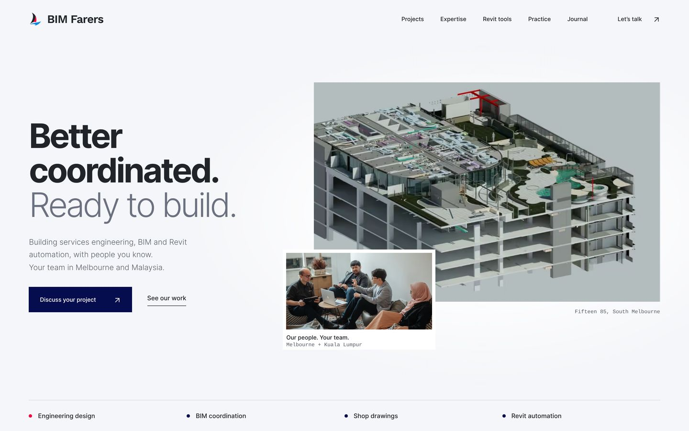

# BIM Farers website

Static HTML, CSS and a small progressive-enhancement script. No framework, package
manager, animation library or production build service is required.

This iteration lives on `design/modern-minimal-refresh`. **Do not merge or deploy
it until the design, content and QA review are complete.** The production branch
is `main` (the repository does not use `master`).



- [Second pass: technical design layer, fixes and proposals](docs/SECOND-PASS.md)
- [Design audit and recommendations](docs/DESIGN-REVIEW.md)
- [QA handoff for Claude or another reviewer](docs/QA-HANDOFF.md)
- [Current performance evidence](docs/OPTION-A-PERFORMANCE.md)
- [Original full-site performance comparison](docs/PERFORMANCE.md)
- Previews: [mobile](docs/previews/mobile.png), [full home](docs/previews/home-full.jpg),
  [Revit tools](docs/previews/tools-full.jpg), [practice](docs/previews/practice-full.jpg),
  [journal](docs/previews/journal-full.jpg), [brand palette](docs/previews/palette.png)

## Edit and preview

```sh
git switch design/modern-minimal-refresh
python scripts/build.py
python scripts/check.py
python scripts/preview.py --port 8000
```

Open `http://127.0.0.1:8000`. Internal links use the canonical extensionless
addresses (`/aboutus`), which GitHub Pages and the preview server both serve.
The site assumes hosting at the root of its domain, as configured by `CNAME`.

Edit these source files, then run `python scripts/build.py` and commit the
generated root HTML files alongside the source:

| Area | Source |
| --- | --- |
| Page content | `content/*.html` |
| Titles, descriptions, navigation state and page JSON-LD | `content/pages.json`, `content/*.schema.html`, `content/*.jsonld.html` |
| Shared document, header and footer | `templates/*.html` |
| Layout, colours (Canva brand tokens), responsive rules and motion | `css/site.css` |
| Proposal ribbon graphic | `scripts/make_waves.py` → `assets/waves.svg` |
| Review previews and social card | `scripts/make_previews.py` (optional, needs Playwright) |
| Mobile menu / optional section motion | `js/navigation.js` (inlined) / `js/site.js` |
| Optimised images | `assets/optimized/` |

The generator only shares the HTML shell. It uses Python's standard library and
emits ready-to-serve HTML; Python is not needed by the deployed site. Original
images remain in `assets/` as sources. `map.html` is the Google Maps locator
embedded on the Practice page; it loads only when a visitor scrolls near it. The
deploy workflow publishes site files only, not `content/`, `templates/`,
`scripts/` or `docs/`.

The approved hero is option A: the team photo overlaps the model on desktop and
tucks below it on phones. Typography restores the original light/bold Inter
weights and Work Sans wordmark. Menu code in `js/navigation.js` is inserted at
the end of the header, so it initialises before the main content can paint and
avoids a late menu collapse. `js/site.js` only adds optional below-fold motion.
Fonts and images are committed, optimised assets; their preparation script is
optional. See [font packaging](fonts/README.md) and
[responsive evidence](docs/RESPONSIVE-QA.md).

## Optional browser checks

Install Playwright in your own development environment, then use installed
Chromium or install Playwright's browser:

```sh
python -m pip install playwright
python -m playwright install chromium
python scripts/browser_check.py
python scripts/responsive_check.py
```

This checks all ten redesigned pages at four widths, image loading, browser
errors, third-party requests, keyboard navigation, no-JavaScript use, reduced
motion and the nested 404. Screenshots are written to a temporary directory.
The responsive suite additionally exercises 23 viewport sizes, landscape,
200% text enlargement, reflow, retina image selection and WebP fallbacks.

`scripts/check.py` runs in GitHub Actions on iteration-branch pushes and PRs. It
checks links, assets, anchors, heading order, IDs, schema, image dimensions and
size budgets. The deployment workflow only permits `refs/heads/main`, including
manual runs.
