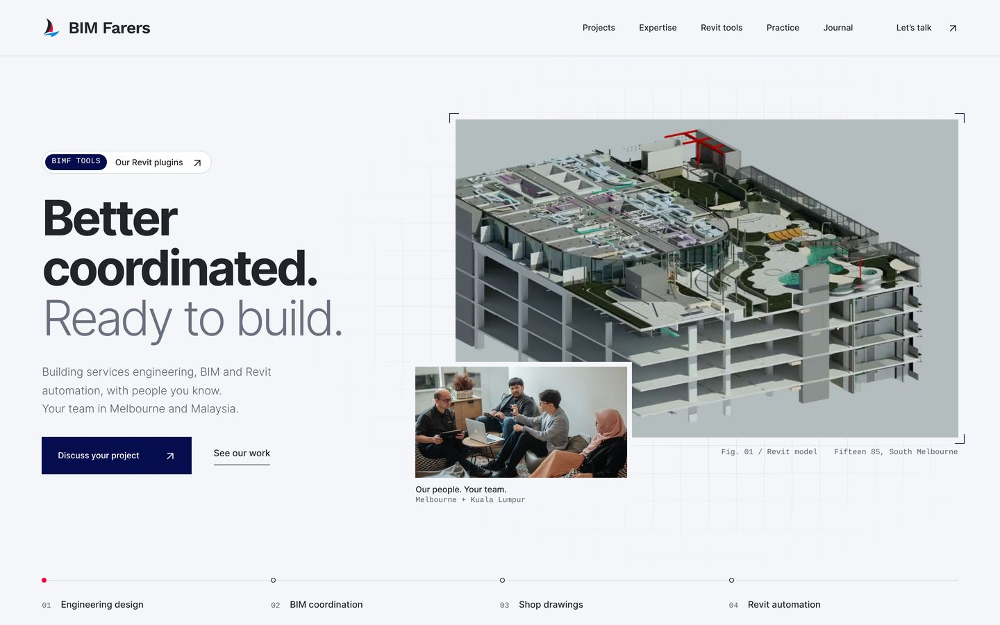
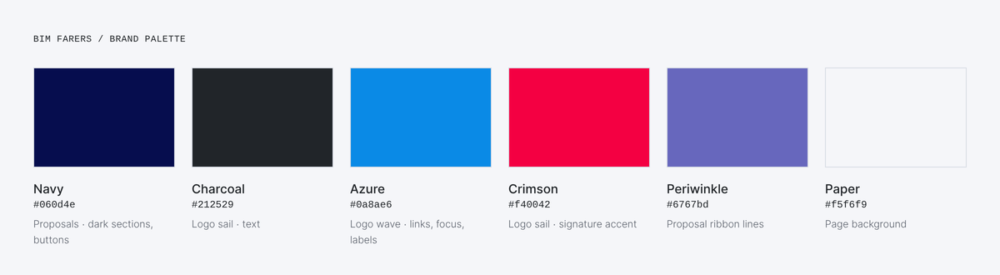

# Second pass: technical design layer, 6 November 2026

Review branch: `design/modern-minimal-refresh`, on top of the approved option A hero.
Nothing has been merged or deployed.

The first pass produced a clean editorial site, but it read like an architecture
studio. The brief for this pass was a firm at the front of BIM technology, closer
in feel to an AI or developer-tools company. The Inter hierarchy, Work Sans
wordmark and option A hero stay. This pass adds a technical layer on top of
them, brings the firm's own software back to the front, and replaces the first
pass's sage-and-warm-paper colours with the brand palette from Canva.

## Brand colour alignment (Canva)

The Canva account has no Brand Kit, so the palette was sampled from the branded
designs: the *BIM Farers Logo* file, the *Service Proposal* covers (the most
recent collateral) and the letterhead. The logo colours match the site's
existing `assets/brand.svg` exactly.

| Token | Colour | Canva source | Used for |
| --- | --- | --- | --- |
| `--navy` | `#060d4e` | Proposal background | Expertise and enquiry sections, primary buttons, pill tag, crop marks |
| `--ink` | `#212529` | Logo sail and wordmark | Text |
| `--azure` | `#0a8ae6` | Logo wave | Labels on navy, focus ring; `#0868b8` for small text on light backgrounds |
| `--crimson` | `#f40042` | Logo sail, letterhead icons | One signature accent: the first pipeline node |
| Periwinkle | `#6767bd` | Proposal ribbon lines | `assets/waves.svg`, behind the enquiry band |
| `--paper` | `#f5f6f9` | Cool white, as in the logo artboards | Page background |

- **Proposal ribbon.** The flowing line ribbon from the proposal covers is
  recreated as a 10 KB SVG (3.7 KB gzip), generated by `scripts/make_waves.py`.
  It sits behind every enquiry band and is dimmed behind the text so the copy
  stays readable.
- **Developer section.** The Revit tools custom-development section uses a
  charcoal "terminal" surface rather than navy. That keeps it distinct from the
  navy enquiry band directly below it.
- **Contrast.** All text pairs pass WCAG AA: muted text 5.9:1, azure on navy 4.9:1,
  small azure text 5.3:1, navy body text 10.7:1, code comments 5.9:1.
- **Social card.** `assets/social-card.jpg` is now a proposal-style navy card with
  the headline and model, rather than a plain crop of the render.
- **Previews.** Previews are regenerated with `python scripts/make_previews.py` (desktop,
  phones, full-length Home, Revit tools, Practice and Journal, the palette sheet
  and the social card).

## What changed

### Design system

| Change | Why | Cost |
| --- | --- | --- |
| Monospace labels for eyebrows, captions, specs and metadata | Reads as a specification sheet, as on AI and developer-tool sites | None. Uses the system monospace font (SF Mono, Consolas, Menlo) |
| Drafting-grid backdrop behind the hero, faded with a mask | Suggests drafting paper and model space without competing with the render | CSS gradient only |
| CAD crop marks around the hero model (tablet and desktop) | Frames the model like a drawing viewport | One pseudo-element |
| Translucent, blurred sticky header | Modern product-site convention; content stays visible underneath | Solid fallback where `backdrop-filter` is unsupported |
| Numbered delivery pipeline replaces the discipline strip | Shows the service as a sequence of stages | Same DOM size |
| Large footer wordmark sized with container units | Strong brand sign-off; fits the content column at every width | Uses the already-embedded wordmark font |
| Minimum text size raised to 11px | Several 8–10px captions were hard to read on phones | — |

### Pages

- **Home:** the hero has a "BIMF Tools" pill linking to the plugins, and a "See our
  work" link next to the main button. The intro now names the disciplines, since
  the old eyebrow was replaced. The model caption is a figure label. A new
  **03 / Software** section shows BIMF Tools as product cards (available, in
  development, custom). The software stack is shown as tags. The enquiry block
  lists what to include, and its email opens with a short project-brief template.
- **Revit tools:** this was a thin page with a link to the App Store. It is now a product
  page. The pipe penetration tool has a feature list, the real plugin screenshot
  in an app-window frame and an inset line drawing of the penetration element.
  The ceiling height tool has its own section. A dark custom development section
  includes an illustrative Revit API code sample, the Autodesk Authorised
  Developer badge and the three-step process. The product copy comes from the
  owner's July 2024 homepage (`a36a36c`). The feature list matches what the
  plugin screenshot shows.
- **Practice:** a facts row (founded, studios, disciplines, developer status)
  with a visible "Credentials" label above the badges. All facts are taken from
  existing site copy.
- **Journal:** removed an inline style. All pages pick up the new labels and footer.

### Fixes found in review

- **Canonical host mismatch.** Canonical tags used `www.bimfarers.com.au`, but the
  sitemap, `robots.txt` and article JSON-LD used the apex domain. `CNAME` is `www`, so all
  now use `www`.
- **Missing organisation data.** The homepage now has `ProfessionalService` JSON-LD
  with both addresses, phone, email and founding year, generated through a new
  `jsonld` key in `content/pages.json`.
- **Social image.** The default `og:image` was a WebP file. Not every social platform
  supports WebP, so there is a 1200×630 JPG card (`assets/social-card.jpg`) with size hints.
- **Canonical on `noindex` pages.** The 404 and payment return pages declared a canonical
  URL. They no longer do.
- **Oversized tools image.** The tools page loaded a 1695px, 230 KB screenshot into
  a box about 700px wide. It now uses a 960px AVIF (76 KB) or WebP (93 KB).
- **CSS budget.** The 20 KB raw budget was already used up (19,995 bytes).
  `scripts/check.py` now checks transfer size (≤9 KB gzip) with a 32 KB raw
  ceiling. The stylesheet is about 7.9 KB gzip, up from 6.2 KB.

### Verification

`build.py`, `check.py`, `responsive_check.py` (23 viewport sizes, landscape,
200% zoom and text enlargement, DPR 2/3, WebP fallback) and `browser_check.py`
(ten pages × four widths, keyboard menu, no-JS, reduced motion, nested 404, no
third-party requests) all pass in Chromium. New text colours meet WCAG AA
(muted 5.2:1, code comments 5.3:1, status green 5.8:1). Safari, iOS and Firefox still
need checking on real devices.

## Please verify before release

1. **Ceiling height tool status.** It is shown as *In development*. The last published
   status was "Coming soon" in July 2024. Change it to *Available* or remove it if
   that is out of date.
2. **App Store link.** Buttons go to the publisher page, which is the safe choice. If the
   pipe penetration listing is still live
   (`apps.autodesk.com/RVT/en/Detail/Index?id=5576484736911034483`), point the
   main button straight at it.
3. **Restored product copy.** Check the 2024 feature wording is still accurate:
   sloped pipes, cast-in exclusion, automatic diameter and thickness, and the default family.
4. **Code sample.** It is an illustrative Revit API pattern, not the plugin's source.
   The calls are real (`FilteredElementCollector`, `BoundingBoxIntersectsFilter`).
5. **Organisation data.** Phone, both addresses and the 2022 founding year in the
   new JSON-LD.
6. **Monospace font.** System fonts differ by platform. For identical labels everywhere,
   self-host a small JetBrains Mono or IBM Plex Mono subset (about 10 KB).

## Proposed next improvements (not implemented)

These need business input, new assets or a decision on third-party services.

### Home
- **Case studies.** Turn two or three project tiles into short case-study pages:
  trades, deliverables, stage, tools and one measured outcome. This is the
  biggest credibility gain still available.
- **Evidence strip.** Bring back dated, sourced figures, such as Revit hours or
  project value "as at 2026". The old 17.2k and $1.89b counters are still omitted.
- **Client logo strip** once permissions are confirmed. The old logo assets are
  still in `assets/`.

### Revit tools
- **Demo clip.** `assets/HRes-Plugin.mp4` is a 6-second, 1.6 MB demo. Re-encode it
  to about 300 KB (AV1/H.264, 960px, no audio). Then show it with a poster image
  and `preload="none"`, playing on click or when visible, and never under reduced motion.
- **Changelog and support.** Add a short changelog, supported Revit versions and
  an install/support section. Release notes are a strong signal for technical buyers.
- **Product pages.** When there are three or more tools, give each its own URL
  (`/tools/pipe-penetrations`) for search and sharing.

### Practice
- **Roles.** Add a role and specialty under each name. People pages without roles
  read as unfinished, and roles have never been published.
- **Credentials.** Add a one-line caption to each badge (what the NER, BLA and ADN
  registrations allow you to do).

### Journal
- **New articles.** Publish new pieces, for example on penetration coordination, Revit
  automation case notes and model QA. Add an RSS feed and reading time
  (the build script can calculate it).

### Site-wide
- **Dark mode.** The palette maps well to a dark theme, and the dark green sections
  already preview it. Renders need checking against both themes.
- **Enquiry form.** The site only offers email. A form needs a provider such as
  Formspree, Microsoft Forms or a Power Automate endpoint, which is a third-party
  decision for the owner.
- **Interactive model.** A small glTF viewer of a cleaned-up services model on
  the tools page would be the most "AI-firm" feature. It should load only on
  click, so the homepage budget is unaffected.
- **Cleanup.** Remove the legacy Bootstrap/AOS bundles, `css/theme.css` (295 KB)
  and `map.html` once this direction is approved. They are not loaded but make
  the repository harder to maintain.
