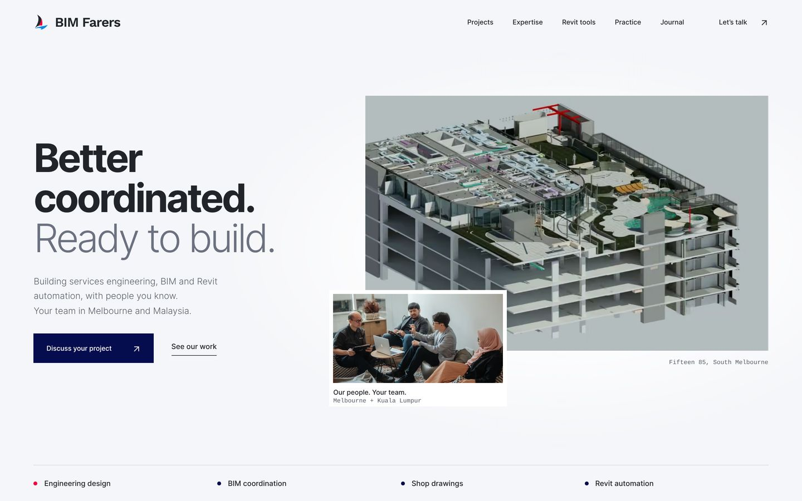
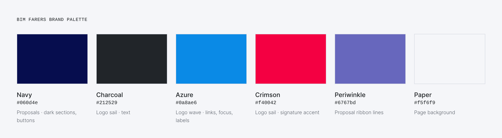

# Second pass: technical design layer, 6 November 2026

Review branch: `design/modern-minimal-refresh`, on top of the approved option A hero.
Nothing has been merged or deployed.

The first pass produced a clean editorial site, but it read like an architecture
studio. The brief for this pass was a firm at the front of BIM technology, closer
in feel to an AI or developer-tools company. The Inter hierarchy, Work Sans
wordmark and option A hero stay. This pass adds a technical layer on top of
them, brings the firm's own software back to the front, and replaces the first
pass's sage-and-warm-paper colours with the brand palette from Canva.

## Brand colour alignment (Canva)

The Canva account has no Brand Kit, so the palette was sampled from the branded
designs: the *BIM Farers Logo* file, the *Service Proposal* covers (the most
recent collateral) and the letterhead. The logo colours match the site's
existing `assets/brand.svg` exactly.

| Token | Colour | Canva source | Used for |
| --- | --- | --- | --- |
| `--navy` | `#060d4e` | Proposal background | Expertise and enquiry sections, primary buttons |
| `--ink` | `#212529` | Logo sail and wordmark | Text |
| `--azure` | `#0a8ae6` | Logo wave | Labels on navy, focus ring; `#0868b8` for small text on light backgrounds |
| `--crimson` | `#f40042` | Logo sail, letterhead icons | One signature accent: the first pipeline dot |
| Periwinkle | `#6767bd` | Proposal ribbon lines | `assets/waves.svg`, behind the enquiry band |
| `--paper` | `#f5f6f9` | Cool white, as in the logo artboards | Page background |

- **Proposal ribbon.** The flowing line ribbon from the proposal covers is
  recreated as a 10 KB SVG (3.7 KB gzip), generated by `scripts/make_waves.py`.
  It sits behind every enquiry band and is dimmed behind the text so the copy
  stays readable.
- **Developer section.** The Revit tools custom-development section uses a
  charcoal "terminal" surface rather than navy. That keeps it distinct from the
  navy enquiry band directly below it.
- **Contrast.** All text pairs pass WCAG AA: muted text 5.9:1, azure on navy 4.9:1,
  small azure text 5.3:1, navy body text 10.7:1, code comments 5.9:1.
- **Social card.** `assets/social-card.jpg` is now a proposal-style navy card with
  the headline and model, rather than a plain crop of the render.
- **Previews.** Previews are regenerated with `python scripts/make_previews.py` (desktop,
  phones, full-length Home, Revit tools, Practice and Journal, the palette sheet
  and the social card).

## What changed

### Design system

| Change | Why | Cost |
| --- | --- | --- |
| Monospace labels for eyebrows, captions, specs and metadata, without section numbers or slashes | Reads as a specification sheet, as on AI and developer-tool sites | None. Uses the system monospace font (SF Mono, Consolas, Menlo) |
| Soft white glow that spreads out from the hero image | Lifts the model off the page without extra graphics | One CSS gradient |
| Translucent, blurred sticky header | Modern product-site convention; content stays visible underneath | Solid fallback where `backdrop-filter` is unsupported |
| Delivery pipeline with a dot per stage replaces the discipline strip | Shows the service as a sequence of stages | Same DOM size |
| Large footer wordmark sized with container units | Strong brand sign-off; fits the content column at every width | Uses the already-embedded wordmark font |
| Minimum text size raised to 11px | Several 8–10px captions were hard to read on phones | — |

### Pages

- **Home:** the hero has a "See our work" link next to the main button, and the
  intro names the disciplines. "What we do" has a team portrait with an
  overlapping close-up beside the four services, echoing the hero overlap. A new
  **Software** section shows BIMF Tools as product cards (available, in
  development, custom). The software stack is shown as tags. The enquiry block
  lists what to include, and its email opens with a short project-brief template.
- **Revit tools:** this was a thin page with a link to the App Store. It is now a product
  page. The pipe penetration tool has a feature list, the real plugin screenshot
  in an app-window frame and an inset line drawing of the penetration element.
  The ceiling height tool has its own section. A dark custom development section
  includes an illustrative Revit API code sample, the Autodesk Authorised
  Developer badge and the three-step process. The product copy comes from the
  owner's July 2024 homepage (`a36a36c`). The feature list matches what the
  plugin screenshot shows.
- **Practice:** a facts row under the photo: founded, offices, and the
  credential badges (moved up from further down the page). All facts are taken
  from existing site copy.
- **Journal:** removed an inline style. All pages pick up the new labels and footer.

### Owner review, round 3

Changes made from the owner's marked-up screenshots:

- **Numbers and slashes.** No section numbers or slashes in labels ("01 / What we do"
  is now "What we do"). Numbers remain only where they identify something: the
  BIMF Tools products and process steps on the Revit tools page, and journal dates.
- **Hero.** Removed the BIMF Tools pill, the CAD crop marks, the drafting grid
  and the "Fig. 01 / Revit model" label. A soft white glow now spreads out from
  the model image.
- **Pipeline.** Each stage has a dot instead of a number (crimson first, then navy).
- **What we do.** Added the unused *Career* photo as a portrait, with the
  *Discuss2* close-up overlapping it, beside the four services (which lost their
  01–04 numbers). Both are placeholders until new photography is chosen. They
  are re-encoded at 15–28 KB and lazy-loaded.
- **Practice.** "Studios" is now "Offices". Disciplines and Developer were removed and the
  credential badges moved up into the facts row. The photo caption was removed.
- **Test fix.** `browser_check.py` now caps its wait for each image at 5 seconds. A
  hidden lazy image would otherwise hang the suite instead of failing clearly.

### Motion (round 4)

Short, quiet movement only: 120–450 ms, one easing curve, 14 px of travel at most.
No loaders, parallax, scroll hijacking or looping animation.

- **Page load.** Headline, intro and buttons rise in sequence (60 ms apart), the
  team photo follows, and the model settles from a 3.5% zoom. The model image
  never fades, so it still paints immediately.
- **Scroll.** Section headings, cards and photos fade up as they enter, with rows
  staggered left to right. `js/site.js` only hides elements that start below the
  screen, so nothing is hidden without JavaScript and nothing flashes.
- **Page changes.** Cross-document view transitions give a 180 ms cross-fade
  while the header stays in place (browsers without support navigate normally).
- **Scroll-linked.** The header rule appears once the page moves, and articles
  show a thin reading-progress line. Both are CSS only, where supported.
- **Feedback.** Buttons press in slightly, product cards lift, journal titles
  change colour, and the phone menu fades in.
- **Reduced motion.** All of it is off when the visitor's device asks for reduced motion.

### Fixes found in review

- **Canonical host mismatch.** Canonical tags used `www.bimfarers.com.au`, but the
  sitemap, `robots.txt` and article JSON-LD used the apex domain. `CNAME` is `www`, so all
  now use `www`.
- **Missing organisation data.** The homepage now has `ProfessionalService` JSON-LD
  with both addresses, phone, email and founding year, generated through a new
  `jsonld` key in `content/pages.json`.
- **Social image.** The default `og:image` was a WebP file. Not every social platform
  supports WebP, so there is a 1200×630 JPG card (`assets/social-card.jpg`) with size hints.
- **Canonical on `noindex` pages.** The 404 and payment return pages declared a canonical
  URL. They no longer do.
- **Oversized tools image.** The tools page loaded a 1695px, 230 KB screenshot into
  a box about 700px wide. It now uses a 960px AVIF (76 KB) or WebP (93 KB).
- **CSS budget.** The 20 KB raw budget was already used up (19,995 bytes).
  `scripts/check.py` now checks transfer size (≤9 KB gzip) with a 32 KB raw
  ceiling. The stylesheet is about 7.9 KB gzip, up from 6.2 KB.

### Verification

`build.py`, `check.py`, `responsive_check.py` (23 viewport sizes, landscape,
200% zoom and text enlargement, DPR 2/3, WebP fallback) and `browser_check.py`
(ten pages × four widths, keyboard menu, no-JS, reduced motion, nested 404, no
third-party requests) all pass in Chromium. New text colours meet WCAG AA
(muted 5.2:1, code comments 5.3:1, status green 5.8:1). Safari, iOS and Firefox still
need checking on real devices.

## Final review (round 6)

### Map
- The Google Maps locator (`map.html`, unchanged apart from its title, language
  and a `noindex` tag) is embedded on the Practice page again. The first redesign
  had replaced it with two static pictures.
- It loads when the visitor scrolls within 600 px of it. The browser's built-in
  `loading="lazy"` was tested first and loaded Google's code on every page open.
- Tested with Google reachable: the locator loads, lists both offices and
  responds to clicks. Google refused the map tiles on the test address
  (`RefererNotAllowedMapError`), which shows the API key is restricted to the
  production domain. The tiles therefore need confirming on the real site.

### SEO and best practice
- Internal links use the canonical extensionless addresses, matching the
  canonical tags and sitemap.
- The Journal index no longer skips from `h1` to `h3`.
- Articles have 1200×630 JPG share images and shorter titles (the brand is in
  `og:site_name`).
- The web manifest is linked, with correct name, colours and icon paths.
- The deploy workflow publishes site files only. `content/`, `templates/`,
  `scripts/` and `docs/` were previously public, including duplicate page
  fragments. The step uses `tar` and was tested locally: 11 pages, no missing files.

### Efficiency
- Team portraits 316 KB → 84 KB; Journal cards 384 KB → 67 KB; project tiles
  gain AVIF versions (312 KB → 183 KB).
- The bold font is preloaded only on the homepage, the one page that uses it.
- Removed 2.9 MB of unreferenced Bootstrap, AOS, carousel and `theme.css`.
- Budgets in `scripts/check.py`: CSS ≤10 KB gzip (36 KB raw), JS ≤4 KB.
- Measured in Chromium with gzip: no layout shift on any main page.

### Layout
- One shared grid: three equal columns with a 32 px gutter. Section labels sit in
  column one; headings, service lists, tags, the contact block, footer columns,
  page intros and the Tools page visuals all start at column two.
- Neighbouring sections on the same background share one gap (about 1.3× the
  section padding) instead of two stacked paddings.
- Portrait tablets no longer force the hero to full screen height.

## Full audit (round 7)

A sweep of every page and file with independent tools, not only the project's
own checks.

| Tool | Scope | Result |
| --- | --- | --- |
| Lighthouse 12, phone emulation, throttled | Home (×3), Practice, Revit tools, Journal, an article, privacy policy | 100 performance, 100 accessibility, 100 best practices, 100 SEO on each |
| axe-core, WCAG 2.0–2.2 A/AA and best practices | All ten pages at 1440 and 390 px, menu open on phones | 0 issues (was 2) |
| html-validate, recommended rules | All ten pages | 0 errors (was 35) |
| csstree validator, `node --check` | Stylesheet and both scripts | Valid |
| GitHub Actions "Check static site" | Every push to this branch | Passing |
| Keyboard walk | Home, Practice, Revit tools, an article | Skip link first; every stop has a visible focus ring |

The 404 page scores 66 for SEO in Lighthouse only because it is deliberately `noindex`.

### Fixed in this round
- **Accessibility.** The decorative footer wordmark was a contrast failure on every
  page; it is now drawn by CSS and is no longer page text. The code sample scrolls
  sideways on phones and is now reachable by keyboard.
- **Markup.** Phone numbers no longer wrap mid-number. Article citation anchors
  are `cite-1` rather than `1`. Removed an `aria-label` that had no effect.
- **Loading.** The first Journal card was lazy-loaded although it is on the first
  screen on phones. The Practice hero has AVIF and a 960 px step (73 KB → 29 KB
  on a typical phone). The plugin screenshot, Journal cards and credential badges
  have right-sized versions. The Tools screenshot no longer claims high priority
  when it is below the fold on phones.
- **Main thread.** The header rule animates opacity instead of a border colour,
  and the reveal script measures all elements before changing any.
- **Fonts.** The middle dot used in bylines was missing from the Inter subsets
  and fell back to another font; it is now included. A zero-width space was
  removed from one article.
- **Print.** The navy and charcoal sections printed as white text on white paper.
  They now print as black on white, and screen-only parts are hidden.
- **Journal.** Articles end with "All articles" and the next article; the index
  ends with the same enquiry band as the other main pages. One article linked
  to another through the full apex-domain address; it is now an internal link.
- **Housekeeping.** Removed two unused hero derivatives. `scripts/check.py` now
  also fails on skipped heading levels, IDs that start with a digit and internal
  `.html` links. Older first-pass documents carry a "historical record" note.

### Not verifiable from this environment
- **External links.** Outside websites are blocked here, so these could not be
  checked. The 2023 article references are the ones most likely to have moved:

- <https://home.kpmg/au/en/home/insights/2023/06/global-construction-survey-trends-2023.html> (3-construction-recap-2023)
- <https://investor.trimble.com/news/news-details/2023/Trimble-and-Meta-Bring-SketchUp-to-Meta-Quest-VR-Headsets/default.aspx> (3-construction-recap-2023)
- <https://stream-measurement.com/jwfmedia/products/flow/natural-gas-flow-meters/itron-cyble/itron-automatic-meter-reading-diagram.jpg> (2-built-to-rent)
- <https://twitter.com/JacintaAllanMP/status/1604708587527630849/photo/2> (3-construction-recap-2023)
- <https://www.google.com/maps/search/?api=1&query=6+Jalan+Kia+Peng+50450+Kuala+Lumpur> (aboutus)
- <https://www.google.com/maps/search/?api=1&query=678+Victoria+Street+Richmond+Victoria+3121> (aboutus)
- <https://www.health.vic.gov.au/covid-19-infection-prevention-control-guidelines/ventilation> (2-built-to-rent)
- <https://www.mitsubishicomfort.com/articles/what-is-all-electric-vrf-technology> (2-built-to-rent)
- <https://www.scottcarver.com.au/our-projects/gladstone-st-south-melbourne-vic> (2-built-to-rent)
- <https://www.skynews.com.au/business/finance/richstone-group-collapses-owing-creditors-22-million-and-leaving-150-staff-without-a-job-following-complications/news-story/17f5fcafc4b2200f5f72631666e9abf7> (3-construction-recap-2023)
- <https://www.theurbandeveloper.com/articles/gurner-qualitas-raise-12bn-build-to-rent-war-chest> (2-built-to-rent)
- <https://www.vic.gov.au/housing-statement> (2-built-to-rent)
- <https://apps.autodesk.com/en/Publisher/PublisherHomepage?ID=RKMJZP6LKPCYL5XJ> (every page)

- **Caching.** Lighthouse notes short cache lifetimes. GitHub Pages fixes these
  at 10 minutes and they cannot be changed from the repository.
- **Render-blocking stylesheet.** Lighthouse notes the 9 KB stylesheet. It is one
  small cached file shared by all pages; inlining it would cost more than it saves.
- **Map tiles**, real Safari/iOS and Firefox: see below.

### Left in place on purpose
- **Source media.** 6.9 MB of original photos, renders and two videos in
  `assets/` are not used by any page. They are the sources for the optimised
  versions and may be linked from outside the site (for example the Autodesk
  App Store listing), so they stay until the owner decides.

## Please verify before release

0. **Map on the real domain.** Open the Practice page on the live or preview site
   and confirm the map tiles appear. A preview subdomain must be added to the
   API key's allowed websites in Google Cloud Console, or the map will show
   Google's error message there.

1. **Ceiling height tool status.** It is shown as *In development*. The last published
   status was "Coming soon" in July 2024. Change it to *Available* or remove it if
   that is out of date.
2. **App Store link.** Buttons go to the publisher page, which is the safe choice. If the
   pipe penetration listing is still live
   (`apps.autodesk.com/RVT/en/Detail/Index?id=5576484736911034483`), point the
   main button straight at it.
3. **Restored product copy.** Check the 2024 feature wording is still accurate:
   sloped pipes, cast-in exclusion, automatic diameter and thickness, and the default family.
4. **Code sample.** It is an illustrative Revit API pattern, not the plugin's source.
   The calls are real (`FilteredElementCollector`, `BoundingBoxIntersectsFilter`).
5. **Organisation data.** Phone, both addresses and the 2022 founding year in the
   new JSON-LD.
6. **Monospace font.** System fonts differ by platform. For identical labels everywhere,
   self-host a small JetBrains Mono or IBM Plex Mono subset (about 10 KB).

## Proposed next improvements (not implemented)

These need business input, new assets or a decision on third-party services.

### Home
- **Case studies.** Turn two or three project tiles into short case-study pages:
  trades, deliverables, stage, tools and one measured outcome. This is the
  biggest credibility gain still available.
- **Evidence strip.** Bring back dated, sourced figures, such as Revit hours or
  project value "as at 2026". The old 17.2k and $1.89b counters are still omitted.
- **Client logo strip** once permissions are confirmed. The old logo assets are
  still in `assets/`.

### Revit tools
- **Demo clip.** `assets/HRes-Plugin.mp4` is a 6-second, 1.6 MB demo. Re-encode it
  to about 300 KB (AV1/H.264, 960px, no audio). Then show it with a poster image
  and `preload="none"`, playing on click or when visible, and never under reduced motion.
- **Changelog and support.** Add a short changelog, supported Revit versions and
  an install/support section. Release notes are a strong signal for technical buyers.
- **Product pages.** When there are three or more tools, give each its own URL
  (`/tools/pipe-penetrations`) for search and sharing.

### Practice
- **Roles.** Add a role and specialty under each name. People pages without roles
  read as unfinished, and roles have never been published.
- **Credentials.** Add a one-line caption to each badge (what the NER, BLA and ADN
  registrations allow you to do).

### Journal
- **New articles.** Publish new pieces, for example on penetration coordination, Revit
  automation case notes and model QA. Add an RSS feed and reading time
  (the build script can calculate it).

### Site-wide
- **Dark mode.** The palette maps well to a dark theme, and the dark green sections
  already preview it. Renders need checking against both themes.
- **Enquiry form.** The site only offers email. A form needs a provider such as
  Formspree, Microsoft Forms or a Power Automate endpoint, which is a third-party
  decision for the owner.
- **Interactive model.** A small glTF viewer of a cleaned-up services model on
  the tools page would be the most "AI-firm" feature. It should load only on
  click, so the homepage budget is unaffected.
